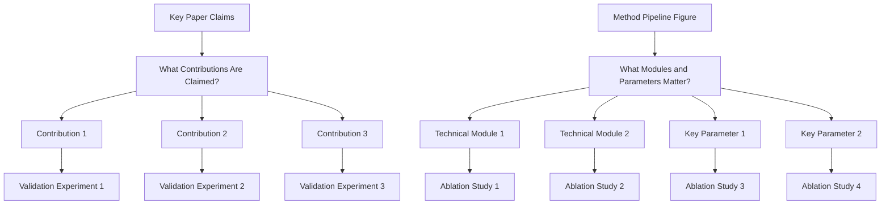
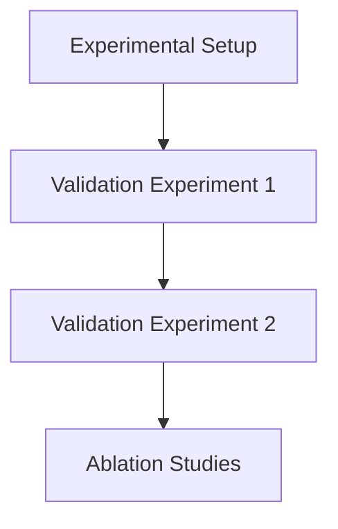

# Experiments Writing Guide

## Goal

Convince reviewers with complete evidence on effectiveness, causality, and practical value.

## Three Core Questions

1. Is the method better than strong baselines?
   - Run comparison experiments against strong and recent baselines.
   - Report standard metrics on the main benchmark(s).
   - Include SOTA or strongest public methods, not only weak baselines.
   - Keep protocol fair (same data split, preprocessing, and evaluation settings).
2. Which modules/design choices make the gain?
   - Run ablation studies for each key module/design choice.
   - Use remove/replace/disable variants and report delta to full model.
   - Include component interaction ablations when modules are coupled.
3. How far can the method generalize under harder settings?
   - Run demos/evaluations on harder or out-of-distribution settings.
   - Add stress-test scenarios (more complex scenes, rarer cases, noisier inputs, or stricter constraints).
   - Report both gains and failure modes to show realistic boundaries.

## Experiment Planning

## Experiment Section Decomposition

## Figure/Table Writing Rules

`Good tables are part of experiment communication quality, not decoration.`

1. Figure captions and table captions are equally important in the writing quality of Experiments.

### Hard rules

1. Put caption above the table.
2. Avoid vertical lines (`|`) in tabular columns.
3. Do not use double rules or dense `\hline` stacks.
4. Use `booktabs` style (`\toprule`, `\midrule`, `\bottomrule`) for clean structure.
5. Use as few horizontal rules as possible; lines should separate groups, not every row.
6. Highlight key numbers (best/second-best or target rows) with subtle color emphasis.

### Readability rules from review practice

1. Label metric direction in column headers (for example `PSNR ↑`, `LPIPS ↓`).
2. Add units when needed so values are interpretable without guessing.
3. Align text columns left; keep numeric columns consistently aligned.
4. Keep numeric precision consistent (same decimal places within a metric column).
5. Group multi-dataset or multi-setting results using `\multicolumn` + `\cmidrule`, not vertical separators.
6. One table, one message: do not mix unrelated results in a single table.
7. If rows represent different attributes/ablations, encode that explicitly in row names or attribute columns.
8. Keep caption focused on setting/protocol/notation, not long discussion.
9. If there is little detail to explain, use one concise sentence to summarize the main result.
10. For single-column figures/tables in two-column papers, prefer placing them in the right column when layout allows, so readers can enter the page from the left-top text without breaking reading flow.

### Minimal LaTeX checklist

1. Add packages in preamble: `\usepackage{booktabs}`, `\usepackage{colortbl,xcolor}` (and optionally `\usepackage{siunitx}` for decimal alignment).
2. Replace `\hline`-heavy style with `\toprule/\midrule/\bottomrule`.
3. Put `\caption{...}` before `\label{...}` and keep caption above.
4. Use restrained highlighting; never color too many cells.

## Recommended Ablation Package

1. One core ablation table for all major contributions.
2. Several focused mini-ablations for module-level design choices.
3. Matching qualitative visual results for each important ablation.

## Experimental Rigor Checklist

1. Are baselines recent and relevant?
2. Are metrics sufficient and standard for this task?
3. Is ablation tied to every key design claim?
4. Are claims in Abstract/Introduction supported by reported numbers?
5. Are limitations of evaluation scope explicitly stated?

## Additional Skills — from *How to Write a Computer Vision Paper* (2026)

### Experimental setup

1. Report implementation details with enough specificity for reproduction: architecture, optimizer, schedule, and compute.
2. Baselines: describe each, state why it is relevant, and explain any adaptation to your setting. Explicitly state which baselines were *not* included and why — this is where reviewers are most likely to object. For SOTA comparisons, briefly justify relevance and note adaptations.

### Fair comparison

1. Fairness is everything — match supervision, backbone, training data, and compute budget. If you cannot match all of these, state the mismatch *and the direction it cuts*. Reviewers assume the worst about any unstated asymmetry ("Our method beats X" is weak if it used 3× the compute).
2. Use the strongest available baseline, not the most convenient one. Comparing against a 2-year-old method when a recent stronger one exists (especially with open-source code) is a fast path to rejection.
3. Run baselines yourself when possible. Copying numbers from the original paper is acceptable only when the setup matches exactly; when in doubt, rerun.
4. If a baseline beats you on some metric, say so — pretending otherwise is worse than losing on that metric. Honest reporting of where you lose (and why: different trade-off/regime) is trusted.
5. Include a "naive" baseline (nearest-neighbor lookup, zero-shot pretrained model, trivial heuristic). It either makes your gains more impressive or saves you from claiming gains that don't exist.

### Results, variance, and honesty

1. Qualitative results must always include failure cases. A paper without them is immediately suspicious. Choose *explainable* failures — ideally ones where strong baselines also struggle — and discuss them honestly.
2. Report statistics and variance: confidence intervals, standard deviations across seeds (mean ± std over ≥3 seeds for main claims), or significance tests. Single-seed numbers are treated with growing skepticism.
3. User studies are necessary when the metric is controversial, perceptual, or poorly correlated with ground truth (generation quality, aesthetics, realism). Design them properly: sufficient participant count, randomized ordering, clear instructions, and reported inter-rater agreement.
4. Do not cherry-pick qualitative results — reviewers can often tell, and lost trust in one figure propagates to the whole paper. Include a random sample in the supplement.
5. Do not run the same experiment until you get a good seed and report only that — this is scientific misconduct. If a result depends on a lucky seed, it isn't a result.

### Efficiency and scaling

1. Report wall-clock time and peak memory on concrete/real hardware, not just FLOPs. FLOP-only arguments are increasingly unconvincing, especially with attention variants where FLOP counts and actual latency diverge.
2. Be careful with marginal gains. A 0.3 mAP improvement on a saturated benchmark is rarely convincing alone. Reviewers want gains that hold across seeds, on held-out/harder splits, and that scale with model/data size, plus ablations showing *which* component caused the gain. A modest gain with a clear mechanistic explanation beats a large gain with no insight into *why*.
3. Test on more than the easiest benchmark. Winning only on the most saturated dataset looks suspicious — pick a benchmark where your method should struggle and show you handle it reasonably.
4. Show scaling behavior (performance vs. model size, data size, or compute) when the method plausibly has one — reviewers increasingly expect this even when scaling isn't the core claim.

### Ablations (expanded)

1. An ablation is a controlled experiment isolating one component — not a table of "variants we tried."
2. Change one variable at a time. Ablating two things simultaneously teaches you nothing about either.
3. Ablate what you claim, claim what you ablate. Every contribution in the intro should correspond to at least one ablation row, and every ablation row should tie back to a claim. Link each ablation to its contribution explicitly (a checkmark in the contributions table or a callback in the caption).
4. Present ablations alongside insight, not just numbers — each should end with a sentence stating what it demonstrates.
5. If removing a component barely hurts, be honest: cut it, or demote it from "contribution" to "implementation detail."
6. Ablate hyperparameters chosen non-obviously (e.g., a loss weight of 0.3 → show 0.1 and 1.0). Unmotivated magic numbers are a reviewer-magnet.

### Figures and tables craft

1. Figures and tables *are* the paper for many reviewers. A time-pressed reviewer skims figures, reads captions, glances at tables, and forms ~70% of their opinion before reading the body.
2. Every figure must earn its space. If you can't state in one sentence what a figure demonstrates, cut it.
3. Captions are self-contained and a second chance to make your point. A reader flipping through should learn the claim from the caption alone. "Comparison of methods on dataset X" is wasted; "Our method preserves fine-grained structure where baseline Y oversmooths (red arrows)" is a working caption.
4. Tables are arguments, not data dumps: bold the winning row, gray out settings that aren't directly comparable, put the metrics that matter most on the left, and include a ↑/↓ arrow for every metric.
5. Use consistent color coding across the whole paper (if red = your method in Figure 3, red = your method in Figure 7). Reviewers build visual muscle memory.
6. Never submit a figure with unreadable text. If a reviewer must zoom to 200% to read axis labels, the figure fails — print the paper on actual paper to check.
7. Experiments are the proof the story is true: every table/figure should correspond to a narrative beat — "we claimed X, here is evidence of X."
