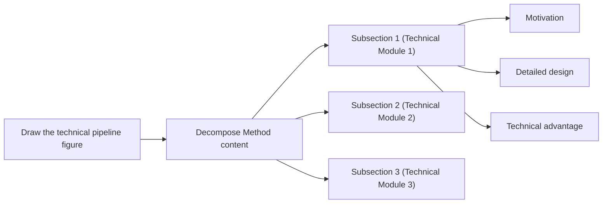
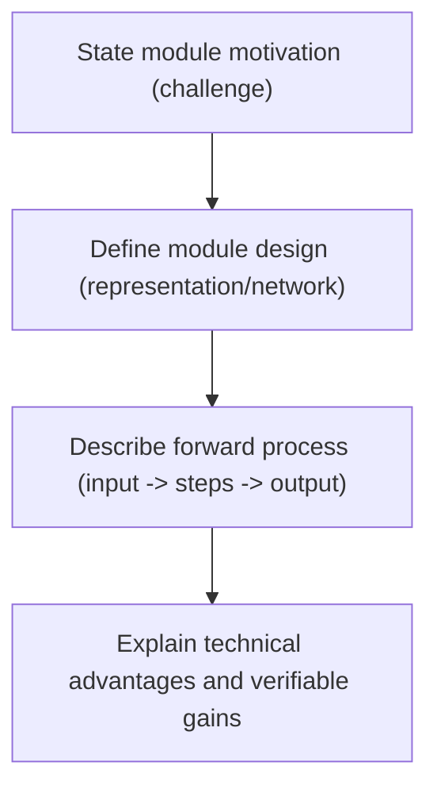

# Method Writing Guide

## Goal

Write the Method section clearly by following this sequence:

1. Answer key method-design questions.
2. Draw a pipeline figure sketch.
3. Write the method section step by step.

## Pre-Writing Questions

`Before writing Method, first answer: (1) what modules exist in the method, and (2) for each module, what is the workflow, why this module is needed, and why this module works.`

Recommended organization:

1. List all modules in the pipeline.
2. For each module, answer three questions:

- How does the module run?
- Why do we need this module?
- Why does this module work?

3. Organize answers as a mind map or a table for clarity.

## Method Writing Steps

`Method writing steps: (1) draw pipeline figure sketch, (2) map subsections from the sketch, (3) plan each subsection with motivation/design/advantages, (4) write module design first, (5) then add motivation and technical advantages.`

Step-by-step workflow:

1. Draw the pipeline figure sketch.
2. Use the sketch to organize Method subsection structure.
3. For each subsection, plan three parts: motivation, module design, and technical advantages.
4. Write module design first to build a concrete backbone.
5. Add motivation and technical advantages afterward.

## Three Elements of a Pipeline Module

`A pipeline module has three elements: Module design, Motivation of this module, and Technical advantages of this module.`

### 1) Module Design

Definition:

1. Describe representation/network/data-structure details.
2. Describe the forward process clearly: given input -> step 1 -> step 2 -> step 3 -> output.

### 2) Motivation of This Module

Definition:

1. Explain why this module is needed.
2. Use problem-driven logic: because problem X exists, we design module Y.

### 3) Technical Advantages of This Module

Definition:

1. Explain why this module has technical advantage over alternatives.
2. Tie advantage to measurable behavior when possible.

### Example of the Three Elements

Local cite:

1. `references/examples/method/example-of-the-three-elements.md`

## Method Content Decomposition



## How to Write Module Design

`Module design usually has two parts: (1) describe specific data/network structures, and (2) describe forward process as input -> steps -> output.`

Writing structure:

1. Define key structures first (representation, network, data structure).
2. Write forward process in strict execution order.
3. End with output interpretation or purpose.

Sentence skeleton:

1. `We represent ... with ...`
2. `Given [input], we first ... then ... finally ...`
3. `This produces [output], which is used for ...`

Local cite:

1. `references/examples/method/module-design-instant-ngp.md`

## How to Write Module Motivation

`Module motivation is usually problem-driven: because a problem exists, we design xx to solve it.`

Typical opening sentences:

1. `A remaining problem/challenge is ...`
2. `However, we ...`
3. `Previous methods have difficulty in ...`

Local cite:

1. `references/examples/method/module-motivation-patterns.md`

## How to Check Whether Method is Easy to Understand

`Check method clarity from three levels: writing logic, paragraph writing, and sentence writing.`

### 1) Logic-level check

1. After finishing the paper, summarize the Method writing logic again.
2. Check whether this summarized logic is smooth and easy to follow.

### 2) Paragraph-level check

1. The first sentence of each paragraph should make readers immediately understand what this paragraph is about.
2. One paragraph should clearly deliver one message.

### 3) Sentence-level check

1. Carefully check whether the **motivation** of each sentence is explicit. Keep one thing clear to readers at all times: **why this sentence content is needed**.
2. Carefully check sentence-to-sentence flow.
3. Carefully check term consistency and avoid changing key terms back and forth.

## Method Section Skeleton

```latex
\section{Method}
% Overview
% Section 3.1
% Section 3.2
% Section 3.3
```

Local cite:

1. `references/examples/method/section-skeleton.md`

## Overview Subsection

`Overview should usually include: setting, core contribution, optional pipeline figure pointer, and a map of what each subsection contains.`

Writing structure:

1. One to two sentences for task setting.
2. One to two sentences for core contribution.
3. If pipeline/framework is novel, point to overview figure.
4. Tell readers what Section 3.1/3.2/3.3 covers.

Local cite:

1. `references/examples/method/overview-template.md`

## Section 3.1 and Other Module Subsections

`Basic subsection logic: (1) motivation of this module, (2) module forward process/module design, (3) technical advantages of this module.`

Local cite:

1. `references/examples/method/example-of-the-three-elements.md`

## Module Writing Pattern (Mermaid)



## Implementation Details

`Implementation details include hyperparameters (e.g., layer count, feature dimensions), coordinate transforms/normalization, and other practical details. Put them near the end of Method or in a dedicated Implementation Details section.`

## Example Bank

1. `references/examples/method-examples.md`
2. `references/examples/method/pre-writing-questions.md`
3. `references/examples/method/module-triad-neural-body.md`
4. `references/examples/method/module-design-instant-ngp.md`
5. `references/examples/method/module-motivation-patterns.md`
6. `references/examples/method/section-skeleton.md`
7. `references/examples/method/overview-template.md`
8. `references/examples/method/example-of-the-three-elements.md`
9. `references/examples/method/method-writing-common-issues-note.md`

## Additional Skills — from *How to Write a Computer Vision Paper* (2026)

### Preliminaries / Background (the *What* context)

1. Two subsections: Problem Setting and Background. Problem Setting formally introduces inputs, outputs, and constraints, and defines notation to be reused consistently; if the setting is novel this is especially important — it pins down what you are actually claiming to solve. Background covers only the minimum technical material the Method directly builds on.
2. Inclusion test for any preliminary: does the Method section use it directly? If not, cut it. Over-included background reads as padding; a tight preliminaries section signals confidence.

### Analyses and Motivation (the *Why*)

1. Include this when the method is *not* an obvious consequence of well-known theory. Its job is to establish two things: (1) prior methods have a *specific, identifiable* limitation — ideally shown with a controlled experiment, a diagnostic visualization, or a short formal argument; (2) your method is *principled* — it targets that limitation through a mechanism whose reasonableness can be articulated, not asserted.
2. A single clean diagnostic experiment that isolates *why* prior methods fail (and shows yours doesn't fail the same way) is often worth more than three comparison tables. It converts "here is another method that works" into "here is why this method works and others don't."
3. Maturity check: if you cannot articulate the core mechanism in one or two sentences, the method is not yet mature — go back to the whiteboard.

### Method section craft

1. Overview subsection = one paragraph + the method diagram, after which the reader can state, in their own words, what the method does *and why*.
2. One subsection per contribution, each following What–Why–How. The *Why* (why it is reasonable — a theoretical argument, empirical observation, or principled analogy) is what separates a method paper from an engineering report. The *How* gives the general picture first, then the reproduction details.
3. Do not conflate *what* with *how* — the most common method-section failure. State the mechanism in plain language before formalizing it. Heuristic: if you stripped out every equation, could a reader still follow the logic? If not, you're hiding the idea behind the math.
4. Justify every non-obvious design choice (a loss term, an architectural component, a training schedule) with at least one sentence on why it was chosen over the obvious alternative. Gold standard: *"We use X because otherwise Y fails, as we show in Section Z."*
5. Notation discipline (expanded): introduce symbols only when needed, never reuse the same letter for different quantities, never introduce notation you never use again, and include a small notation table in the appendix as cheap insurance.
6. State your assumptions explicitly and, where possible, give a concise theoretical justification. A short proposition stating *why* an assumption is reasonable, or a derivation showing your loss reduces to a known objective under specific conditions, often does more work than pages of heavy analysis and carries disproportionate weight with reviewers.
7. Narrative job of Method: it is the *how* of the story but must continually remind the reader of the *why* — each subsection should open by linking back to the problem it addresses, not by diving into equations.

### Dataset Contribution (if applicable)

1. Treat a new dataset as a first-class contribution, with What–Why–How: What it is (domain, modality, task, scale); Why it is needed (what gap existing datasets don't fill); How it was built — data sources and selection criteria; annotation protocol (guidelines, annotator pool, quality control, inter-annotator agreement); statistics (counts, distributions, coverage) with a comparison table against existing datasets; qualitative examples that make the distinctiveness visible.
2. Dataset papers live or die on trust. Reviewers must believe the annotations are accurate, the collection is unbiased, and the scale is real. Be upfront about limitations — annotation noise rates, class imbalance, demographic coverage, licensing. Hiding problems gets rejected; surfacing and mitigating them honestly gets accepted.
3. Release plans matter. State clearly what will be released, when, and under what license — reviewers increasingly check.
